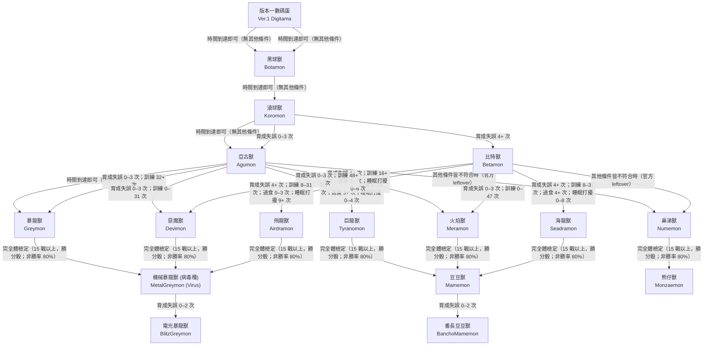
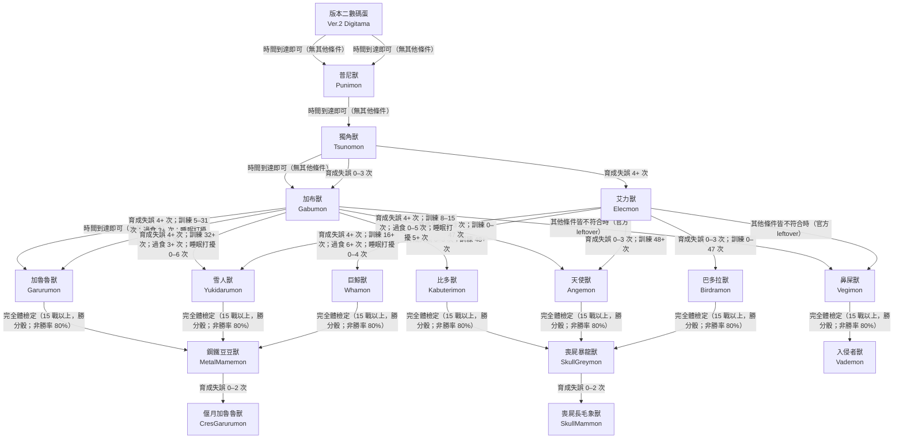
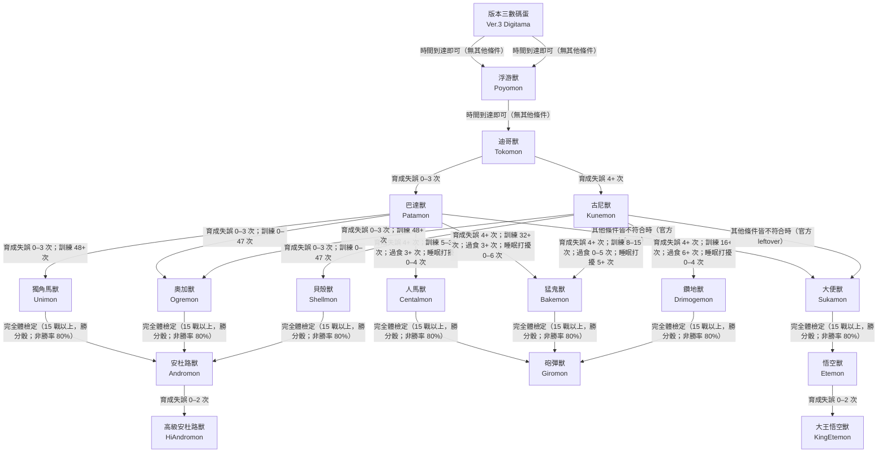
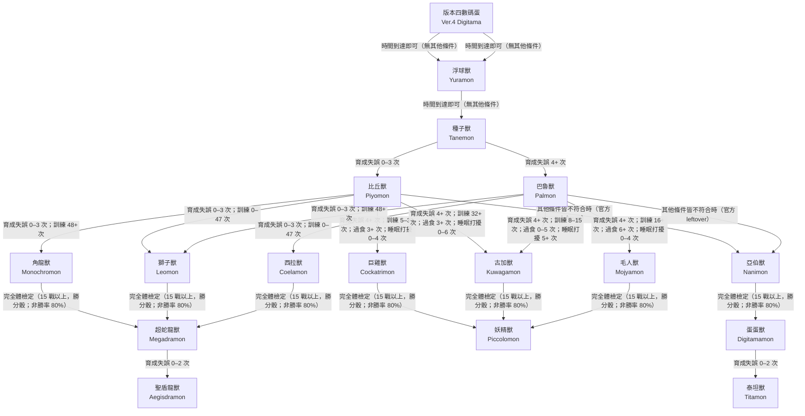
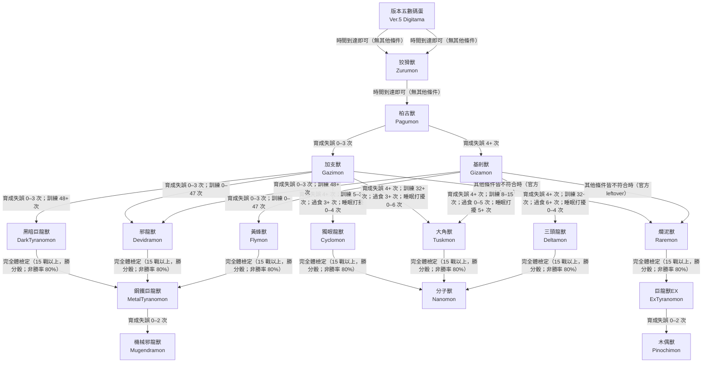

# 數碼怪獸對打機進化表

Digital Monster Ver.1–Ver.5 official branches, plus Ver.20th Anniversary Mega (究極體) and optional Jogress.

本表由 `js/evolution-data.js` 自動匯出，與遊戲及自動化測試使用同一份條件表。優先順序為列表由上到下，第一條符合的規則生效；最後的 leftover／stay 為官方後備。

條件欄位：育成失誤（calls / care mistakes）、訓練次數、過食、睡眠打擾、體重、對戰場次、勝率、本階段時間。體重欄位已預留，官方 Ver.1–5／20th 標準蛋路線不使用體重作為進化門檻。

## 資料來源與規則摘要

- 1997 Digital Monster Ver.1–5 firmware (E0C6200, measured disassembly) is the source of truth for care, timers, battles, and Perfect evolution. DM20 rules are used only for Mega, Jogress, and 20th-exclusive eggs.
- Rookie (Child) branches: Wikimon / firmware-agreed conditions (care mistakes, training, overfeed, sleep disturbances). Ver.1 Agumon/Betamon overfeed splits and Ver.2 Elecmon's 16-training split are firmware-measured. Ver.3–5 analogous 16-splits are kept as community/counterpart tables and are labelled unverified as firmware-measured only for Elecmon.
- Ver.1 training: any training session counts (even fail or cancel). Ver.2–5: only successful training counts (Wikimon).
- Care mistakes (calls): firmware 20-minute call (0x08C3). Hunger and strength empty together produce ONE call and at most one mistake. After a mistake the call does not retrigger until the meter is filled. Lights left on 20 minutes after falling asleep also counts, once per night. Calls cap at 15.
- Counters (calls, train, overfeed, sleep disturbances, injuries, protein overdose / power-up, boost care-down) RESET when the Digimon evolves. Battles, wins, losses, win score (0–15), and the Perfect-qualified bit CARRY from Child (Rookie) into Adult (Champion). proteinRemainder (0–3) also carries. The status screen's lifetime battle totals (通算成績) are separate and do not decide evolution.
- Champion → Ultimate (完全體 / Perfect): firmware — 15 or more battles (carried from Child), then a win-score roll at both III→IV and IV→V. Win score 0–4 / 5–8 / 9–15 rolls 1/8, 1/4, 1/2 (die 0–15, assumed die < 2 / 4 / 8). Either success is enough (combined cap 75%, never 100%). If both fail, or battles < 15 at the Adult window, the Digimon stays Champion. This is NOT an 80% win-rate gate and NOT a 100% NHOKO table.
- Lifespan is a per-species 8-hour dice window rolled at stage entry (firmware §17), not a flat 72 h / 24 h. Old-age death is the 5th care mistake after the window elapsed, not lifespan×1.6. Baby I is 50–59 minutes, or 60–69 if a tens die is ≥ 5.
- Ultimate → Mega (究極體): Digital Monster Ver.20th — 育成ミス 2回以下 (0–2 care mistakes) during the Ultimate stage, after 48 hours AWAKE (timers pause in DM20 sleep). Japanese 20th guide wording (2回以下) is used. Battle count is not required for standard Ver.1–5 megas.
- These ultimates have no Mega in Ver.20th: Monzaemon, Vademon, Giromon, Piccolomon, Nanomon. They use the 1997 Perfect lifespan window, then 5 care mistakes.
- Standard Ver.1 Mega is BlitzGreymon (not WarGreymon). Standard Ver.2 Mega from MetalMamemon is CresGarurumon (not MetalGarurumon). WarGreymon / MetalGarurumon appear on optional 20th exclusive anime Digitama.
- Jogress (optional, DM20): tag-battle 5 wins with the official partner (BlitzGreymon+CresGarurumon→Omegamon Alter-S; Aegisdramon+Mugendramon→LastTyranomon/RustTyranomon; WarGreymon+MetalGarurumon→Omegamon; Slayerdramon+Breakdramon→Examon; Apollomon+Dianamon→GraceNovamon).
- 20th special Digitama (Zuba/Hack/Slayerdra/Breakdra/Doru) and exclusive Digitama (anime Agumon/Gabumon, Corona, Luna, Meicoo) use eggKind on shared babies. Special-line Rookie→Champion is unconditional; Champion→Ultimate uses the firmware Perfect roll (not 80% WR); Ultimate→Mega is 0–2 care mistakes after 48 h awake. Hidden: Wingdramon→WarGreymon and Groundramon→MetalGarurumon if 3–4 care mistakes and 100+ battles (Japan wave-2 colors only; overseas / NEW WAVE all colors).
- 20th official raisable count is 134 (nhoko / Humulos IDs 0–133). Colosseum-only and Digital Monster Color-only forms are documented in roster-audit.md and are not in this table.
- Weight is reserved in the condition schema; official Ver.1–5 and 20th Ver.1–5 egg lines do not use weight as an evolution gate.
- Per-species care (sleep hours, 満腹, parameter cycle, Energy/体力, injury base, heal doses) comes from firmware windows where measured, otherwise the NHOKO community table (rules-audit appendix A), labelled. Some Ver.3–5 windows are extrapolated ±4 h from an NHOKO midpoint and are labelled. 20th-only forms without a measured row keep a labelled placeholder (see CARE apply).
- 1997 battles use the official 12×12 slot table (appendix B) plus boost, within the same stage only. Cross-stage fights clamp that result so the lower stage wins at most the stage-gap UPSET (8% / 2% / 0.5%). There is no 1997 attribute triangle.

## 階段對照

| 本遊戲（西式／本表） | 繁中 | 日式原機／Wikimon |
| --- | --- | --- |
| Egg | 數碼蛋 | Digitama |
| Baby I | 幼年期Ⅰ | Baby I |
| Baby II | 幼年期Ⅱ | Baby II |
| Rookie | 成長期 | Child |
| Champion | 成熟期 | Adult |
| Ultimate | 完全體 | Perfect |
| Mega | 究極體 | Ultimate |
| Super Ultimate | 超究極體 | Jogress 合體（可選） |

## Ver.1 — Digital Monster Ver.1 (1997)

### 條件明細（優先順序）

| 目前型態 | 優先 | 進化為 | 條件 |
| --- | ---: | --- | --- |
| **版本一數碼蛋** / Ver.1 Digitama `egg_v1`（數碼蛋 / Egg） | 1 | **黑球獸** / Botamon `botamon`（幼年期Ⅰ / Baby I） | 時間到達即可（無其他條件） |
| **版本一數碼蛋** / Ver.1 Digitama `egg_v1`（數碼蛋 / Egg） | 1 | **黑球獸** / Botamon `botamon`（幼年期Ⅰ / Baby I） | 時間到達即可（無其他條件） |
| **黑球獸** / Botamon `botamon`（幼年期Ⅰ / Baby I） | 1 | **滾球獸** / Koromon `koromon`（幼年期Ⅱ / Baby II） | 時間到達即可（無其他條件） |
| **滾球獸** / Koromon `koromon`（幼年期Ⅱ / Baby II） | 1 | **亞古獸** / Agumon `agumon`（成長期 / Rookie） | 時間到達即可（無其他條件） |
| **滾球獸** / Koromon `koromon`（幼年期Ⅱ / Baby II） | 2 | **亞古獸** / Agumon `agumon`（成長期 / Rookie） | 育成失誤 0–3 次 |
| **滾球獸** / Koromon `koromon`（幼年期Ⅱ / Baby II） | 3 | **比特獸** / Betamon `betamon`（成長期 / Rookie） | 育成失誤 4+ 次 |
| **亞古獸** / Agumon `agumon`（成長期 / Rookie） | 1 | **暴龍獸** / Greymon `greymon`（成熟期 / Champion） | 時間到達即可（無其他條件） |
| **亞古獸** / Agumon `agumon`（成長期 / Rookie） | 2 | **暴龍獸** / Greymon `greymon`（成熟期 / Champion） | 育成失誤 0–3 次；訓練 32+ 次 |
| **亞古獸** / Agumon `agumon`（成長期 / Rookie） | 3 | **惡魔獸** / Devimon `devimon`（成熟期 / Champion） | 育成失誤 0–3 次；訓練 0–31 次 |
| **亞古獸** / Agumon `agumon`（成長期 / Rookie） | 4 | **巨龍獸** / Tyranomon `tyranomon`（成熟期 / Champion） | 育成失誤 4+ 次；訓練 5–15 次；過食 3+ 次；睡眠打擾 0–4 次 |
| **亞古獸** / Agumon `agumon`（成長期 / Rookie） | 5 | **火焰獸** / Meramon `meramon`（成熟期 / Champion） | 育成失誤 4+ 次；訓練 16+ 次；過食 3+ 次；睡眠打擾 0–6 次 |
| **亞古獸** / Agumon `agumon`（成長期 / Rookie） | 6 | **鼻涕獸** / Numemon `numemon`（成熟期 / Champion） | 其他條件皆不符合時（官方 leftover） |
| **比特獸** / Betamon `betamon`（成長期 / Rookie） | 1 | **惡魔獸** / Devimon `devimon`（成熟期 / Champion） | 育成失誤 0–3 次；訓練 48+ 次 |
| **比特獸** / Betamon `betamon`（成長期 / Rookie） | 2 | **火焰獸** / Meramon `meramon`（成熟期 / Champion） | 育成失誤 0–3 次；訓練 0–47 次 |
| **比特獸** / Betamon `betamon`（成長期 / Rookie） | 3 | **飛龍獸** / Airdramon `airdramon`（成熟期 / Champion） | 育成失誤 4+ 次；訓練 8–31 次；過食 0–3 次；睡眠打擾 9+ 次 |
| **比特獸** / Betamon `betamon`（成長期 / Rookie） | 4 | **海龍獸** / Seadramon `seadramon`（成熟期 / Champion） | 育成失誤 4+ 次；訓練 8–31 次；過食 4+ 次；睡眠打擾 0–8 次 |
| **比特獸** / Betamon `betamon`（成長期 / Rookie） | 5 | **鼻涕獸** / Numemon `numemon`（成熟期 / Champion） | 其他條件皆不符合時（官方 leftover） |
| **暴龍獸** / Greymon `greymon`（成熟期 / Champion） | 1 | **機械暴龍獸 (疫苗種)** / MetalGreymon (Vaccine) `metalgreymon_va`（完全體 / Ultimate） | 完全體檢定（15 戰以上，勝分骰；非勝率 80%） |
| **暴龍獸** / Greymon `greymon`（成熟期 / Champion） | 2 | **機械暴龍獸 (病毒種)** / MetalGreymon (Virus) `metalgreymon`（完全體 / Ultimate） | 完全體檢定（15 戰以上，勝分骰；非勝率 80%） |
| **暴龍獸** / Greymon `greymon`（成熟期 / Champion） | 3 | （停留） | 未通過完全體檢定（15 戰以上＋勝分骰）則停留在成熟期 |
| **巨龍獸** / Tyranomon `tyranomon`（成熟期 / Champion） | 1 | **豆豆獸** / Mamemon `mamemon`（完全體 / Ultimate） | 完全體檢定（15 戰以上，勝分骰；非勝率 80%） |
| **巨龍獸** / Tyranomon `tyranomon`（成熟期 / Champion） | 2 | （停留） | 未通過完全體檢定（15 戰以上＋勝分骰）則停留在成熟期 |
| **惡魔獸** / Devimon `devimon`（成熟期 / Champion） | 1 | **機械暴龍獸 (病毒種)** / MetalGreymon (Virus) `metalgreymon`（完全體 / Ultimate） | 完全體檢定（15 戰以上，勝分骰；非勝率 80%） |
| **惡魔獸** / Devimon `devimon`（成熟期 / Champion） | 2 | （停留） | 未通過完全體檢定（15 戰以上＋勝分骰）則停留在成熟期 |
| **火焰獸** / Meramon `meramon`（成熟期 / Champion） | 1 | **豆豆獸** / Mamemon `mamemon`（完全體 / Ultimate） | 完全體檢定（15 戰以上，勝分骰；非勝率 80%） |
| **火焰獸** / Meramon `meramon`（成熟期 / Champion） | 2 | （停留） | 未通過完全體檢定（15 戰以上＋勝分骰）則停留在成熟期 |
| **飛龍獸** / Airdramon `airdramon`（成熟期 / Champion） | 1 | **機械暴龍獸 (病毒種)** / MetalGreymon (Virus) `metalgreymon`（完全體 / Ultimate） | 完全體檢定（15 戰以上，勝分骰；非勝率 80%） |
| **飛龍獸** / Airdramon `airdramon`（成熟期 / Champion） | 2 | （停留） | 未通過完全體檢定（15 戰以上＋勝分骰）則停留在成熟期 |
| **海龍獸** / Seadramon `seadramon`（成熟期 / Champion） | 1 | **豆豆獸** / Mamemon `mamemon`（完全體 / Ultimate） | 完全體檢定（15 戰以上，勝分骰；非勝率 80%） |
| **海龍獸** / Seadramon `seadramon`（成熟期 / Champion） | 2 | （停留） | 未通過完全體檢定（15 戰以上＋勝分骰）則停留在成熟期 |
| **鼻涕獸** / Numemon `numemon`（成熟期 / Champion） | 1 | **熊仔獸** / Monzaemon `monzaemon`（完全體 / Ultimate） | 完全體檢定（15 戰以上，勝分骰；非勝率 80%） |
| **鼻涕獸** / Numemon `numemon`（成熟期 / Champion） | 2 | （停留） | 未通過完全體檢定（15 戰以上＋勝分骰）則停留在成熟期 |
| **機械暴龍獸 (病毒種)** / MetalGreymon (Virus) `metalgreymon`（完全體 / Ultimate） | 1 | **電光暴龍獸** / BlitzGreymon `blitzgreymon`（究極體 / Mega） | 育成失誤 0–2 次 |
| **機械暴龍獸 (病毒種)** / MetalGreymon (Virus) `metalgreymon`（完全體 / Ultimate） | 2 | （停留） | 未達條件則停留在完全體 |
| **豆豆獸** / Mamemon `mamemon`（完全體 / Ultimate） | 1 | **番長豆豆獸** / BanchoMamemon `banchomamemon`（究極體 / Mega） | 育成失誤 0–2 次 |
| **豆豆獸** / Mamemon `mamemon`（完全體 / Ultimate） | 2 | （停留） | 未達條件則停留在完全體 |
| **熊仔獸** / Monzaemon `monzaemon`（完全體 / Ultimate） | 1 | （停留） | 無究極體（停留在完全體） |

## Ver.2 — Digital Monster Ver.2 (1997)

### 條件明細（優先順序）

| 目前型態 | 優先 | 進化為 | 條件 |
| --- | ---: | --- | --- |
| **版本二數碼蛋** / Ver.2 Digitama `egg_v2`（數碼蛋 / Egg） | 1 | **普尼獸** / Punimon `punimon`（幼年期Ⅰ / Baby I） | 時間到達即可（無其他條件） |
| **版本二數碼蛋** / Ver.2 Digitama `egg_v2`（數碼蛋 / Egg） | 1 | **普尼獸** / Punimon `punimon`（幼年期Ⅰ / Baby I） | 時間到達即可（無其他條件） |
| **普尼獸** / Punimon `punimon`（幼年期Ⅰ / Baby I） | 1 | **獨角獸** / Tsunomon `tsunomon`（幼年期Ⅱ / Baby II） | 時間到達即可（無其他條件） |
| **獨角獸** / Tsunomon `tsunomon`（幼年期Ⅱ / Baby II） | 1 | **加布獸** / Gabumon `gabumon`（成長期 / Rookie） | 時間到達即可（無其他條件） |
| **獨角獸** / Tsunomon `tsunomon`（幼年期Ⅱ / Baby II） | 2 | **加布獸** / Gabumon `gabumon`（成長期 / Rookie） | 育成失誤 0–3 次 |
| **獨角獸** / Tsunomon `tsunomon`（幼年期Ⅱ / Baby II） | 3 | **艾力獸** / Elecmon `elecmon`（成長期 / Rookie） | 育成失誤 4+ 次 |
| **加布獸** / Gabumon `gabumon`（成長期 / Rookie） | 1 | **加魯魯獸** / Garurumon `garurumon`（成熟期 / Champion） | 時間到達即可（無其他條件） |
| **加布獸** / Gabumon `gabumon`（成長期 / Rookie） | 2 | **比多獸** / Kabuterimon `kabuterimon`（成熟期 / Champion） | 育成失誤 0–3 次；訓練 48+ 次 |
| **加布獸** / Gabumon `gabumon`（成長期 / Rookie） | 3 | **天使獸** / Angemon `angemon`（成熟期 / Champion） | 育成失誤 0–3 次；訓練 0–47 次 |
| **加布獸** / Gabumon `gabumon`（成長期 / Rookie） | 4 | **加魯魯獸** / Garurumon `garurumon`（成熟期 / Champion） | 育成失誤 4+ 次；訓練 5–31 次；過食 3+ 次；睡眠打擾 0–4 次 |
| **加布獸** / Gabumon `gabumon`（成長期 / Rookie） | 5 | **雪人獸** / Yukidarumon `yukidarumon`（成熟期 / Champion） | 育成失誤 4+ 次；訓練 32+ 次；過食 3+ 次；睡眠打擾 0–6 次 |
| **加布獸** / Gabumon `gabumon`（成長期 / Rookie） | 6 | **鼻屎獸** / Vegimon `vegimon`（成熟期 / Champion） | 其他條件皆不符合時（官方 leftover） |
| **艾力獸** / Elecmon `elecmon`（成長期 / Rookie） | 1 | **天使獸** / Angemon `angemon`（成熟期 / Champion） | 育成失誤 0–3 次；訓練 48+ 次 |
| **艾力獸** / Elecmon `elecmon`（成長期 / Rookie） | 2 | **巴多拉獸** / Birdramon `birdramon`（成熟期 / Champion） | 育成失誤 0–3 次；訓練 0–47 次 |
| **艾力獸** / Elecmon `elecmon`（成長期 / Rookie） | 3 | **雪人獸** / Yukidarumon `yukidarumon`（成熟期 / Champion） | 育成失誤 4+ 次；訓練 8–15 次；過食 0–5 次；睡眠打擾 5+ 次 |
| **艾力獸** / Elecmon `elecmon`（成長期 / Rookie） | 4 | **巨鯨獸** / Whamon `whamon`（成熟期 / Champion） | 育成失誤 4+ 次；訓練 16+ 次；過食 6+ 次；睡眠打擾 0–4 次 |
| **艾力獸** / Elecmon `elecmon`（成長期 / Rookie） | 5 | **鼻屎獸** / Vegimon `vegimon`（成熟期 / Champion） | 其他條件皆不符合時（官方 leftover） |
| **比多獸** / Kabuterimon `kabuterimon`（成熟期 / Champion） | 1 | **喪屍暴龍獸** / SkullGreymon `skullgreymon`（完全體 / Ultimate） | 完全體檢定（15 戰以上，勝分骰；非勝率 80%） |
| **比多獸** / Kabuterimon `kabuterimon`（成熟期 / Champion） | 2 | （停留） | 未通過完全體檢定（15 戰以上＋勝分骰）則停留在成熟期 |
| **加魯魯獸** / Garurumon `garurumon`（成熟期 / Champion） | 1 | **獸人加魯魯獸** / WereGarurumon `weregarurumon`（完全體 / Ultimate） | 完全體檢定（15 戰以上，勝分骰；非勝率 80%） |
| **加魯魯獸** / Garurumon `garurumon`（成熟期 / Champion） | 2 | **鋼鐵豆豆獸** / MetalMamemon `metalmamemon`（完全體 / Ultimate） | 完全體檢定（15 戰以上，勝分骰；非勝率 80%） |
| **加魯魯獸** / Garurumon `garurumon`（成熟期 / Champion） | 3 | （停留） | 未通過完全體檢定（15 戰以上＋勝分骰）則停留在成熟期 |
| **天使獸** / Angemon `angemon`（成熟期 / Champion） | 1 | **喪屍暴龍獸** / SkullGreymon `skullgreymon`（完全體 / Ultimate） | 完全體檢定（15 戰以上，勝分骰；非勝率 80%） |
| **天使獸** / Angemon `angemon`（成熟期 / Champion） | 2 | （停留） | 未通過完全體檢定（15 戰以上＋勝分骰）則停留在成熟期 |
| **雪人獸** / Yukidarumon `yukidarumon`（成熟期 / Champion） | 1 | **鋼鐵豆豆獸** / MetalMamemon `metalmamemon`（完全體 / Ultimate） | 完全體檢定（15 戰以上，勝分骰；非勝率 80%） |
| **雪人獸** / Yukidarumon `yukidarumon`（成熟期 / Champion） | 2 | （停留） | 未通過完全體檢定（15 戰以上＋勝分骰）則停留在成熟期 |
| **巴多拉獸** / Birdramon `birdramon`（成熟期 / Champion） | 1 | **喪屍暴龍獸** / SkullGreymon `skullgreymon`（完全體 / Ultimate） | 完全體檢定（15 戰以上，勝分骰；非勝率 80%） |
| **巴多拉獸** / Birdramon `birdramon`（成熟期 / Champion） | 2 | （停留） | 未通過完全體檢定（15 戰以上＋勝分骰）則停留在成熟期 |
| **巨鯨獸** / Whamon `whamon`（成熟期 / Champion） | 1 | **鋼鐵豆豆獸** / MetalMamemon `metalmamemon`（完全體 / Ultimate） | 完全體檢定（15 戰以上，勝分骰；非勝率 80%） |
| **巨鯨獸** / Whamon `whamon`（成熟期 / Champion） | 2 | （停留） | 未通過完全體檢定（15 戰以上＋勝分骰）則停留在成熟期 |
| **鼻屎獸** / Vegimon `vegimon`（成熟期 / Champion） | 1 | **入侵者獸** / Vademon `vademon`（完全體 / Ultimate） | 完全體檢定（15 戰以上，勝分骰；非勝率 80%） |
| **鼻屎獸** / Vegimon `vegimon`（成熟期 / Champion） | 2 | （停留） | 未通過完全體檢定（15 戰以上＋勝分骰）則停留在成熟期 |
| **喪屍暴龍獸** / SkullGreymon `skullgreymon`（完全體 / Ultimate） | 1 | **喪屍長毛象獸** / SkullMammon `skullmammon`（究極體 / Mega） | 育成失誤 0–2 次 |
| **喪屍暴龍獸** / SkullGreymon `skullgreymon`（完全體 / Ultimate） | 2 | （停留） | 未達條件則停留在完全體 |
| **鋼鐵豆豆獸** / MetalMamemon `metalmamemon`（完全體 / Ultimate） | 1 | **偃月加魯魯獸** / CresGarurumon `cresgarurumon`（究極體 / Mega） | 育成失誤 0–2 次 |
| **鋼鐵豆豆獸** / MetalMamemon `metalmamemon`（完全體 / Ultimate） | 2 | （停留） | 未達條件則停留在完全體 |
| **入侵者獸** / Vademon `vademon`（完全體 / Ultimate） | 1 | （停留） | 無究極體（停留在完全體） |

## Ver.3 — Digital Monster Ver.3 (1998)

### 條件明細（優先順序）

| 目前型態 | 優先 | 進化為 | 條件 |
| --- | ---: | --- | --- |
| **版本三數碼蛋** / Ver.3 Digitama `egg_v3`（數碼蛋 / Egg） | 1 | **浮游獸** / Poyomon `poyomon`（幼年期Ⅰ / Baby I） | 時間到達即可（無其他條件） |
| **版本三數碼蛋** / Ver.3 Digitama `egg_v3`（數碼蛋 / Egg） | 1 | **浮游獸** / Poyomon `poyomon`（幼年期Ⅰ / Baby I） | 時間到達即可（無其他條件） |
| **浮游獸** / Poyomon `poyomon`（幼年期Ⅰ / Baby I） | 1 | **迪哥獸** / Tokomon `tokomon`（幼年期Ⅱ / Baby II） | 時間到達即可（無其他條件） |
| **迪哥獸** / Tokomon `tokomon`（幼年期Ⅱ / Baby II） | 1 | **巴達獸** / Patamon `patamon`（成長期 / Rookie） | 育成失誤 0–3 次 |
| **迪哥獸** / Tokomon `tokomon`（幼年期Ⅱ / Baby II） | 2 | **古尼獸** / Kunemon `kunemon`（成長期 / Rookie） | 育成失誤 4+ 次 |
| **巴達獸** / Patamon `patamon`（成長期 / Rookie） | 1 | **獨角馬獸** / Unimon `unimon`（成熟期 / Champion） | 育成失誤 0–3 次；訓練 48+ 次 |
| **巴達獸** / Patamon `patamon`（成長期 / Rookie） | 2 | **奧加獸** / Ogremon `ogremon`（成熟期 / Champion） | 育成失誤 0–3 次；訓練 0–47 次 |
| **巴達獸** / Patamon `patamon`（成長期 / Rookie） | 3 | **人馬獸** / Centalmon `centalmon`（成熟期 / Champion） | 育成失誤 4+ 次；訓練 5–31 次；過食 3+ 次；睡眠打擾 0–4 次 |
| **巴達獸** / Patamon `patamon`（成長期 / Rookie） | 4 | **猛鬼獸** / Bakemon `bakemon`（成熟期 / Champion） | 育成失誤 4+ 次；訓練 32+ 次；過食 3+ 次；睡眠打擾 0–6 次 |
| **巴達獸** / Patamon `patamon`（成長期 / Rookie） | 5 | **大便獸** / Sukamon `sukamon`（成熟期 / Champion） | 其他條件皆不符合時（官方 leftover） |
| **古尼獸** / Kunemon `kunemon`（成長期 / Rookie） | 1 | **奧加獸** / Ogremon `ogremon`（成熟期 / Champion） | 育成失誤 0–3 次；訓練 48+ 次 |
| **古尼獸** / Kunemon `kunemon`（成長期 / Rookie） | 2 | **貝殼獸** / Shellmon `shellmon`（成熟期 / Champion） | 育成失誤 0–3 次；訓練 0–47 次 |
| **古尼獸** / Kunemon `kunemon`（成長期 / Rookie） | 3 | **猛鬼獸** / Bakemon `bakemon`（成熟期 / Champion） | 育成失誤 4+ 次；訓練 8–15 次；過食 0–5 次；睡眠打擾 5+ 次 |
| **古尼獸** / Kunemon `kunemon`（成長期 / Rookie） | 4 | **鑽地獸** / Drimogemon `drimogemon`（成熟期 / Champion） | 育成失誤 4+ 次；訓練 16+ 次；過食 6+ 次；睡眠打擾 0–4 次 |
| **古尼獸** / Kunemon `kunemon`（成長期 / Rookie） | 5 | **大便獸** / Sukamon `sukamon`（成熟期 / Champion） | 其他條件皆不符合時（官方 leftover） |
| **獨角馬獸** / Unimon `unimon`（成熟期 / Champion） | 1 | **安杜路獸** / Andromon `andromon`（完全體 / Ultimate） | 完全體檢定（15 戰以上，勝分骰；非勝率 80%） |
| **獨角馬獸** / Unimon `unimon`（成熟期 / Champion） | 2 | （停留） | 未通過完全體檢定（15 戰以上＋勝分骰）則停留在成熟期 |
| **人馬獸** / Centalmon `centalmon`（成熟期 / Champion） | 1 | **砲彈獸** / Giromon `giromon`（完全體 / Ultimate） | 完全體檢定（15 戰以上，勝分骰；非勝率 80%） |
| **人馬獸** / Centalmon `centalmon`（成熟期 / Champion） | 2 | （停留） | 未通過完全體檢定（15 戰以上＋勝分骰）則停留在成熟期 |
| **奧加獸** / Ogremon `ogremon`（成熟期 / Champion） | 1 | **安杜路獸** / Andromon `andromon`（完全體 / Ultimate） | 完全體檢定（15 戰以上，勝分骰；非勝率 80%） |
| **奧加獸** / Ogremon `ogremon`（成熟期 / Champion） | 2 | （停留） | 未通過完全體檢定（15 戰以上＋勝分骰）則停留在成熟期 |
| **猛鬼獸** / Bakemon `bakemon`（成熟期 / Champion） | 1 | **砲彈獸** / Giromon `giromon`（完全體 / Ultimate） | 完全體檢定（15 戰以上，勝分骰；非勝率 80%） |
| **猛鬼獸** / Bakemon `bakemon`（成熟期 / Champion） | 2 | （停留） | 未通過完全體檢定（15 戰以上＋勝分骰）則停留在成熟期 |
| **貝殼獸** / Shellmon `shellmon`（成熟期 / Champion） | 1 | **安杜路獸** / Andromon `andromon`（完全體 / Ultimate） | 完全體檢定（15 戰以上，勝分骰；非勝率 80%） |
| **貝殼獸** / Shellmon `shellmon`（成熟期 / Champion） | 2 | （停留） | 未通過完全體檢定（15 戰以上＋勝分骰）則停留在成熟期 |
| **鑽地獸** / Drimogemon `drimogemon`（成熟期 / Champion） | 1 | **砲彈獸** / Giromon `giromon`（完全體 / Ultimate） | 完全體檢定（15 戰以上，勝分骰；非勝率 80%） |
| **鑽地獸** / Drimogemon `drimogemon`（成熟期 / Champion） | 2 | （停留） | 未通過完全體檢定（15 戰以上＋勝分骰）則停留在成熟期 |
| **大便獸** / Sukamon `sukamon`（成熟期 / Champion） | 1 | **悟空獸** / Etemon `etemon`（完全體 / Ultimate） | 完全體檢定（15 戰以上，勝分骰；非勝率 80%） |
| **大便獸** / Sukamon `sukamon`（成熟期 / Champion） | 2 | （停留） | 未通過完全體檢定（15 戰以上＋勝分骰）則停留在成熟期 |
| **安杜路獸** / Andromon `andromon`（完全體 / Ultimate） | 1 | **高級安杜路獸** / HiAndromon `hiandromon`（究極體 / Mega） | 育成失誤 0–2 次 |
| **安杜路獸** / Andromon `andromon`（完全體 / Ultimate） | 2 | （停留） | 未達條件則停留在完全體 |
| **砲彈獸** / Giromon `giromon`（完全體 / Ultimate） | 1 | （停留） | 無究極體（停留在完全體） |
| **悟空獸** / Etemon `etemon`（完全體 / Ultimate） | 1 | **大王悟空獸** / KingEtemon `kingetemon`（究極體 / Mega） | 育成失誤 0–2 次 |
| **悟空獸** / Etemon `etemon`（完全體 / Ultimate） | 2 | （停留） | 未達條件則停留在完全體 |

## Ver.4 — Digital Monster Ver.4 (1998)

### 條件明細（優先順序）

| 目前型態 | 優先 | 進化為 | 條件 |
| --- | ---: | --- | --- |
| **版本四數碼蛋** / Ver.4 Digitama `egg_v4`（數碼蛋 / Egg） | 1 | **浮球獸** / Yuramon `yuramon`（幼年期Ⅰ / Baby I） | 時間到達即可（無其他條件） |
| **版本四數碼蛋** / Ver.4 Digitama `egg_v4`（數碼蛋 / Egg） | 1 | **浮球獸** / Yuramon `yuramon`（幼年期Ⅰ / Baby I） | 時間到達即可（無其他條件） |
| **浮球獸** / Yuramon `yuramon`（幼年期Ⅰ / Baby I） | 1 | **種子獸** / Tanemon `tanemon`（幼年期Ⅱ / Baby II） | 時間到達即可（無其他條件） |
| **種子獸** / Tanemon `tanemon`（幼年期Ⅱ / Baby II） | 1 | **比丘獸** / Piyomon `piyomon`（成長期 / Rookie） | 育成失誤 0–3 次 |
| **種子獸** / Tanemon `tanemon`（幼年期Ⅱ / Baby II） | 2 | **巴魯獸** / Palmon `palmon`（成長期 / Rookie） | 育成失誤 4+ 次 |
| **比丘獸** / Piyomon `piyomon`（成長期 / Rookie） | 1 | **角龍獸** / Monochromon `monochromon`（成熟期 / Champion） | 育成失誤 0–3 次；訓練 48+ 次 |
| **比丘獸** / Piyomon `piyomon`（成長期 / Rookie） | 2 | **獅子獸** / Leomon `leomon`（成熟期 / Champion） | 育成失誤 0–3 次；訓練 0–47 次 |
| **比丘獸** / Piyomon `piyomon`（成長期 / Rookie） | 3 | **巨雞獸** / Cockatrimon `cockatrimon`（成熟期 / Champion） | 育成失誤 4+ 次；訓練 5–31 次；過食 3+ 次；睡眠打擾 0–4 次 |
| **比丘獸** / Piyomon `piyomon`（成長期 / Rookie） | 4 | **古加獸** / Kuwagamon `kuwagamon`（成熟期 / Champion） | 育成失誤 4+ 次；訓練 32+ 次；過食 3+ 次；睡眠打擾 0–6 次 |
| **比丘獸** / Piyomon `piyomon`（成長期 / Rookie） | 5 | **亞伯獸** / Nanimon `nanimon`（成熟期 / Champion） | 其他條件皆不符合時（官方 leftover） |
| **巴魯獸** / Palmon `palmon`（成長期 / Rookie） | 1 | **獅子獸** / Leomon `leomon`（成熟期 / Champion） | 育成失誤 0–3 次；訓練 48+ 次 |
| **巴魯獸** / Palmon `palmon`（成長期 / Rookie） | 2 | **西拉獸** / Coelamon `coelamon`（成熟期 / Champion） | 育成失誤 0–3 次；訓練 0–47 次 |
| **巴魯獸** / Palmon `palmon`（成長期 / Rookie） | 3 | **古加獸** / Kuwagamon `kuwagamon`（成熟期 / Champion） | 育成失誤 4+ 次；訓練 8–15 次；過食 0–5 次；睡眠打擾 5+ 次 |
| **巴魯獸** / Palmon `palmon`（成長期 / Rookie） | 4 | **毛人獸** / Mojyamon `mojyamon`（成熟期 / Champion） | 育成失誤 4+ 次；訓練 16+ 次；過食 6+ 次；睡眠打擾 0–4 次 |
| **巴魯獸** / Palmon `palmon`（成長期 / Rookie） | 5 | **亞伯獸** / Nanimon `nanimon`（成熟期 / Champion） | 其他條件皆不符合時（官方 leftover） |
| **角龍獸** / Monochromon `monochromon`（成熟期 / Champion） | 1 | **超蛇龍獸** / Megadramon `megadramon`（完全體 / Ultimate） | 完全體檢定（15 戰以上，勝分骰；非勝率 80%） |
| **角龍獸** / Monochromon `monochromon`（成熟期 / Champion） | 2 | （停留） | 未通過完全體檢定（15 戰以上＋勝分骰）則停留在成熟期 |
| **巨雞獸** / Cockatrimon `cockatrimon`（成熟期 / Champion） | 1 | **妖精獸** / Piccolomon `piccolomon`（完全體 / Ultimate） | 完全體檢定（15 戰以上，勝分骰；非勝率 80%） |
| **巨雞獸** / Cockatrimon `cockatrimon`（成熟期 / Champion） | 2 | （停留） | 未通過完全體檢定（15 戰以上＋勝分骰）則停留在成熟期 |
| **獅子獸** / Leomon `leomon`（成熟期 / Champion） | 1 | **超蛇龍獸** / Megadramon `megadramon`（完全體 / Ultimate） | 完全體檢定（15 戰以上，勝分骰；非勝率 80%） |
| **獅子獸** / Leomon `leomon`（成熟期 / Champion） | 2 | （停留） | 未通過完全體檢定（15 戰以上＋勝分骰）則停留在成熟期 |
| **古加獸** / Kuwagamon `kuwagamon`（成熟期 / Champion） | 1 | **妖精獸** / Piccolomon `piccolomon`（完全體 / Ultimate） | 完全體檢定（15 戰以上，勝分骰；非勝率 80%） |
| **古加獸** / Kuwagamon `kuwagamon`（成熟期 / Champion） | 2 | （停留） | 未通過完全體檢定（15 戰以上＋勝分骰）則停留在成熟期 |
| **西拉獸** / Coelamon `coelamon`（成熟期 / Champion） | 1 | **超蛇龍獸** / Megadramon `megadramon`（完全體 / Ultimate） | 完全體檢定（15 戰以上，勝分骰；非勝率 80%） |
| **西拉獸** / Coelamon `coelamon`（成熟期 / Champion） | 2 | （停留） | 未通過完全體檢定（15 戰以上＋勝分骰）則停留在成熟期 |
| **毛人獸** / Mojyamon `mojyamon`（成熟期 / Champion） | 1 | **妖精獸** / Piccolomon `piccolomon`（完全體 / Ultimate） | 完全體檢定（15 戰以上，勝分骰；非勝率 80%） |
| **毛人獸** / Mojyamon `mojyamon`（成熟期 / Champion） | 2 | （停留） | 未通過完全體檢定（15 戰以上＋勝分骰）則停留在成熟期 |
| **亞伯獸** / Nanimon `nanimon`（成熟期 / Champion） | 1 | **蛋蛋獸** / Digitamamon `digitamamon`（完全體 / Ultimate） | 完全體檢定（15 戰以上，勝分骰；非勝率 80%） |
| **亞伯獸** / Nanimon `nanimon`（成熟期 / Champion） | 2 | （停留） | 未通過完全體檢定（15 戰以上＋勝分骰）則停留在成熟期 |
| **超蛇龍獸** / Megadramon `megadramon`（完全體 / Ultimate） | 1 | **聖盾龍獸** / Aegisdramon `aegisdramon`（究極體 / Mega） | 育成失誤 0–2 次 |
| **超蛇龍獸** / Megadramon `megadramon`（完全體 / Ultimate） | 2 | （停留） | 未達條件則停留在完全體 |
| **妖精獸** / Piccolomon `piccolomon`（完全體 / Ultimate） | 1 | （停留） | 無究極體（停留在完全體） |
| **蛋蛋獸** / Digitamamon `digitamamon`（完全體 / Ultimate） | 1 | **泰坦獸** / Titamon `titamon`（究極體 / Mega） | 育成失誤 0–2 次 |
| **蛋蛋獸** / Digitamamon `digitamamon`（完全體 / Ultimate） | 2 | （停留） | 未達條件則停留在完全體 |

## Ver.5 — Digital Monster Ver.5 (1998)

### 條件明細（優先順序）

| 目前型態 | 優先 | 進化為 | 條件 |
| --- | ---: | --- | --- |
| **版本五數碼蛋** / Ver.5 Digitama `egg_v5`（數碼蛋 / Egg） | 1 | **狡猾獸** / Zurumon `zurumon`（幼年期Ⅰ / Baby I） | 時間到達即可（無其他條件） |
| **版本五數碼蛋** / Ver.5 Digitama `egg_v5`（數碼蛋 / Egg） | 1 | **狡猾獸** / Zurumon `zurumon`（幼年期Ⅰ / Baby I） | 時間到達即可（無其他條件） |
| **狡猾獸** / Zurumon `zurumon`（幼年期Ⅰ / Baby I） | 1 | **柏古獸** / Pagumon `pagumon`（幼年期Ⅱ / Baby II） | 時間到達即可（無其他條件） |
| **柏古獸** / Pagumon `pagumon`（幼年期Ⅱ / Baby II） | 1 | **加支獸** / Gazimon `gazimon`（成長期 / Rookie） | 育成失誤 0–3 次 |
| **柏古獸** / Pagumon `pagumon`（幼年期Ⅱ / Baby II） | 2 | **基剎獸** / Gizamon `gizamon`（成長期 / Rookie） | 育成失誤 4+ 次 |
| **加支獸** / Gazimon `gazimon`（成長期 / Rookie） | 1 | **黑暗巨龍獸** / DarkTyranomon `darktyranomon`（成熟期 / Champion） | 育成失誤 0–3 次；訓練 48+ 次 |
| **加支獸** / Gazimon `gazimon`（成長期 / Rookie） | 2 | **邪龍獸** / Devidramon `devidramon`（成熟期 / Champion） | 育成失誤 0–3 次；訓練 0–47 次 |
| **加支獸** / Gazimon `gazimon`（成長期 / Rookie） | 3 | **獨眼龍獸** / Cyclomon `cyclomon`（成熟期 / Champion） | 育成失誤 4+ 次；訓練 5–31 次；過食 3+ 次；睡眠打擾 0–4 次 |
| **加支獸** / Gazimon `gazimon`（成長期 / Rookie） | 4 | **大角獸** / Tuskmon `tuskmon`（成熟期 / Champion） | 育成失誤 4+ 次；訓練 32+ 次；過食 3+ 次；睡眠打擾 0–6 次 |
| **加支獸** / Gazimon `gazimon`（成長期 / Rookie） | 5 | **爛泥獸** / Raremon `raremon`（成熟期 / Champion） | 其他條件皆不符合時（官方 leftover） |
| **基剎獸** / Gizamon `gizamon`（成長期 / Rookie） | 1 | **邪龍獸** / Devidramon `devidramon`（成熟期 / Champion） | 育成失誤 0–3 次；訓練 48+ 次 |
| **基剎獸** / Gizamon `gizamon`（成長期 / Rookie） | 2 | **黃蜂獸** / Flymon `flymon`（成熟期 / Champion） | 育成失誤 0–3 次；訓練 0–47 次 |
| **基剎獸** / Gizamon `gizamon`（成長期 / Rookie） | 3 | **大角獸** / Tuskmon `tuskmon`（成熟期 / Champion） | 育成失誤 4+ 次；訓練 8–15 次；過食 0–5 次；睡眠打擾 5+ 次 |
| **基剎獸** / Gizamon `gizamon`（成長期 / Rookie） | 4 | **三頭龍獸** / Deltamon `deltamon`（成熟期 / Champion） | 育成失誤 4+ 次；訓練 32+ 次；過食 6+ 次；睡眠打擾 0–4 次 |
| **基剎獸** / Gizamon `gizamon`（成長期 / Rookie） | 5 | **爛泥獸** / Raremon `raremon`（成熟期 / Champion） | 其他條件皆不符合時（官方 leftover） |
| **黑暗巨龍獸** / DarkTyranomon `darktyranomon`（成熟期 / Champion） | 1 | **鋼鐵巨龍獸** / MetalTyranomon `metaltyranomon`（完全體 / Ultimate） | 完全體檢定（15 戰以上，勝分骰；非勝率 80%） |
| **黑暗巨龍獸** / DarkTyranomon `darktyranomon`（成熟期 / Champion） | 2 | （停留） | 未通過完全體檢定（15 戰以上＋勝分骰）則停留在成熟期 |
| **獨眼龍獸** / Cyclomon `cyclomon`（成熟期 / Champion） | 1 | **分子獸** / Nanomon `nanomon`（完全體 / Ultimate） | 完全體檢定（15 戰以上，勝分骰；非勝率 80%） |
| **獨眼龍獸** / Cyclomon `cyclomon`（成熟期 / Champion） | 2 | （停留） | 未通過完全體檢定（15 戰以上＋勝分骰）則停留在成熟期 |
| **邪龍獸** / Devidramon `devidramon`（成熟期 / Champion） | 1 | **鋼鐵巨龍獸** / MetalTyranomon `metaltyranomon`（完全體 / Ultimate） | 完全體檢定（15 戰以上，勝分骰；非勝率 80%） |
| **邪龍獸** / Devidramon `devidramon`（成熟期 / Champion） | 2 | （停留） | 未通過完全體檢定（15 戰以上＋勝分骰）則停留在成熟期 |
| **大角獸** / Tuskmon `tuskmon`（成熟期 / Champion） | 1 | **分子獸** / Nanomon `nanomon`（完全體 / Ultimate） | 完全體檢定（15 戰以上，勝分骰；非勝率 80%） |
| **大角獸** / Tuskmon `tuskmon`（成熟期 / Champion） | 2 | （停留） | 未通過完全體檢定（15 戰以上＋勝分骰）則停留在成熟期 |
| **黃蜂獸** / Flymon `flymon`（成熟期 / Champion） | 1 | **鋼鐵巨龍獸** / MetalTyranomon `metaltyranomon`（完全體 / Ultimate） | 完全體檢定（15 戰以上，勝分骰；非勝率 80%） |
| **黃蜂獸** / Flymon `flymon`（成熟期 / Champion） | 2 | （停留） | 未通過完全體檢定（15 戰以上＋勝分骰）則停留在成熟期 |
| **三頭龍獸** / Deltamon `deltamon`（成熟期 / Champion） | 1 | **分子獸** / Nanomon `nanomon`（完全體 / Ultimate） | 完全體檢定（15 戰以上，勝分骰；非勝率 80%） |
| **三頭龍獸** / Deltamon `deltamon`（成熟期 / Champion） | 2 | （停留） | 未通過完全體檢定（15 戰以上＋勝分骰）則停留在成熟期 |
| **爛泥獸** / Raremon `raremon`（成熟期 / Champion） | 1 | **巨龍獸EX** / ExTyranomon `extyranomon`（完全體 / Ultimate） | 完全體檢定（15 戰以上，勝分骰；非勝率 80%） |
| **爛泥獸** / Raremon `raremon`（成熟期 / Champion） | 2 | （停留） | 未通過完全體檢定（15 戰以上＋勝分骰）則停留在成熟期 |
| **鋼鐵巨龍獸** / MetalTyranomon `metaltyranomon`（完全體 / Ultimate） | 1 | **機械邪龍獸** / Mugendramon `mugendramon`（究極體 / Mega） | 育成失誤 0–2 次 |
| **鋼鐵巨龍獸** / MetalTyranomon `metaltyranomon`（完全體 / Ultimate） | 2 | （停留） | 未達條件則停留在完全體 |
| **分子獸** / Nanomon `nanomon`（完全體 / Ultimate） | 1 | （停留） | 無究極體（停留在完全體） |
| **巨龍獸EX** / ExTyranomon `extyranomon`（完全體 / Ultimate） | 1 | **木偶獸** / Pinochimon `pinochimon`（究極體 / Mega） | 育成失誤 0–2 次 |
| **巨龍獸EX** / ExTyranomon `extyranomon`（完全體 / Ultimate） | 2 | （停留） | 未達條件則停留在完全體 |

## 可選：20th 動畫限定蛋

這兩條不是 Ver.1／Ver.2 標準蛋的 Mega 路線（標準為電光暴龍獸、偃月加魯魯獸），而是 Ver.20th 機體顏色限定數碼蛋。

### 茲巴數碼蛋（20th特殊） / Zuba Digitama (20th special)

**薩庫獸** / Sakumon `sakumon`（幼年期Ⅰ / Baby I） → **薩庫托獸** / Sakuttomon `sakuttomon`（幼年期Ⅱ / Baby II） → **茲巴獸** / Zubamon `zubamon`（成長期 / Rookie） → **茲巴伊戈獸** / ZubaEagermon `zubaeagermon`（成熟期 / Champion） → **杜蘭獸** / Duramon `duramon`（完全體 / Ultimate） → **杜蘭達獸** / Durandamon `durandamon`（究極體 / Mega）

全版本：戰鬥模式累計 100 勝後可選。共享幼年期薩庫獸／薩庫托獸，以 eggKind 分支。

### 哈克數碼蛋（20th特殊） / Hack Digitama (20th special)

**薩庫獸** / Sakumon `sakumon`（幼年期Ⅰ / Baby I） → **薩庫托獸** / Sakuttomon `sakuttomon`（幼年期Ⅱ / Baby II） → **哈克獸** / Hackmon `hackmon`（成長期 / Rookie） → **刃王哈克獸** / BaoHuckmon `baohackmon`（成熟期 / Champion） → **救星哈克獸** / SaviorHuckmon `saviorhackmon`（完全體 / Ultimate） → **傑斯獸** / Jesmon `jesmon`（究極體 / Mega）

全版本：戰鬥模式累計 50 勝後可選。

### 龍仔獸藍蛋／斬龍（20th特殊） / Slayerdra Digitama (20th special, black egg)

**小龍獸** / Petitmon `petitmon`（幼年期Ⅰ / Baby I） → **幼龍獸** / Babydmon `babydmon`（幼年期Ⅱ / Baby II） → **龍仔獸** / Dracomon `dracomon`（成長期 / Rookie） → **核龍獸 (藍)** / Coredramon (Blue) `coredramon_blue`（成熟期 / Champion） → **翔龍獸** / Wingdramon `wingdramon`（完全體 / Ultimate） → **斬龍獸** / Slayerdramon `slayerdramon`（究極體 / Mega）

官方為黑蛋。翔龍獸在育成ミス 3–4 且對戰 100 場以上時可變戰鬥暴龍獸（日本版僅後發三色；海外／NEW WAVE 全色可進化）。

### 龍仔獸綠蛋／破壞龍（20th特殊） / Breakdra Digitama (20th special, white egg)

**小龍獸** / Petitmon `petitmon`（幼年期Ⅰ / Baby I） → **幼龍獸** / Babydmon `babydmon`（幼年期Ⅱ / Baby II） → **龍仔獸** / Dracomon `dracomon`（成長期 / Rookie） → **核龍獸 (綠)** / Coredramon (Green) `coredramon_green`（成熟期 / Champion） → **地龍獸** / Groundramon `groundramon`（完全體 / Ultimate） → **破壞龍獸** / Breakdramon `breakdramon`（究極體 / Mega）

官方為白蛋。地龍獸在育成ミス 3–4 且對戰 100 場以上時可變鋼鐵加魯魯獸（日本版僅後發三色）。

### 多路數碼蛋（20th特殊） / Doru Digitama (20th special)

**多多獸** / Dodomon `dodomon`（幼年期Ⅰ / Baby I） → **多利獸** / Dorimon `dorimon`（幼年期Ⅱ / Baby II） → **多路獸** / DORUmon `dorumon`（成長期 / Rookie） → **多路加獸** / DORUgamon `dorugamon`（成熟期 / Champion） → **多路龍獸** / DORUguremon `doruguremon`（完全體 / Ultimate） → **阿爾法獸** / Alphamon `alphamon`（究極體 / Mega）

兩台成功連線後雙方解鎖。

### 動畫亞古獸數碼蛋（20th限定） / Anime Agumon Digitama (20th exclusive)

**黑球獸** / Botamon `botamon`（幼年期Ⅰ / Baby I） → **滾球獸** / Koromon `koromon`（幼年期Ⅱ / Baby II） → **亞古獸** / Agumon `agumon`（成長期 / Rookie） → **暴龍獸** / Greymon `greymon`（成熟期 / Champion） → **機械暴龍獸 (疫苗種)** / MetalGreymon (Vaccine) `metalgreymon_va`（完全體 / Ultimate） → **戰鬥暴龍獸** / WarGreymon `wargreymon`（究極體 / Mega）

官方 Ver.1 究極體為電光暴龍獸，不是戰鬥暴龍獸。此蛋為線性路線（條件無）。

### 動畫加布獸數碼蛋（20th限定） / Anime Gabumon Digitama (20th exclusive)

**普尼獸** / Punimon `punimon`（幼年期Ⅰ / Baby I） → **獨角獸** / Tsunomon `tsunomon`（幼年期Ⅱ / Baby II） → **加布獸** / Gabumon `gabumon`（成長期 / Rookie） → **加魯魯獸** / Garurumon `garurumon`（成熟期 / Champion） → **獸人加魯魯獸** / WereGarurumon `weregarurumon`（完全體 / Ultimate） → **鋼鐵加魯魯獸** / MetalGarurumon `metalgarurumon`（究極體 / Mega）

官方 Ver.2 從鋼鐵豆豆獸進化的究極體是偃月加魯魯獸，不是鋼鐵加魯魯獸。

### 日冕數碼蛋（20th限定） / Corona Digitama (20th exclusive)

**比基獸** / Pichimon `pichimon`（幼年期Ⅰ / Baby I） → **布加獸** / Pukamon `pukamon`（幼年期Ⅱ / Baby II） → **日冕獸** / Coronamon `coronamon`（成長期 / Rookie） → **焰獅獸** / Firamon `firamon`（成熟期 / Champion） → **耀獅獸** / Flaremon `flaremon`（完全體 / Ultimate） → **阿波羅獸** / Apollomon `apollomon`（究極體 / Mega）

奧米加獸配色機限定蛋。與露娜蛋共享比基獸／布加獸。

### 露娜數碼蛋（20th限定） / Luna Digitama (20th exclusive)

**比基獸** / Pichimon `pichimon`（幼年期Ⅰ / Baby I） → **布加獸** / Pukamon `pukamon`（幼年期Ⅱ / Baby II） → **露娜獸** / Lunamon `lunamon`（成長期 / Rookie） → **雷克斯獸** / Lekismon `lekismon`（成熟期 / Champion） → **新月獸** / Crescemon `crescemon`（完全體 / Ultimate） → **狄安娜獸** / Dianamon `dianamon`（究極體 / Mega）

阿爾法獸配色機限定蛋。

### 梅可可數碼蛋（20th限定） / Meicoo Digitama (20th exclusive)

**雪球獸** / Yukimibotamon `yukimibotamon`（幼年期Ⅰ / Baby I） → **貓貓獸** / Nyaromon `nyaromon`（幼年期Ⅱ / Baby II） → **小狗獸** / Plotmon `plotmon`（成長期 / Rookie） → **緬因貓獸** / Meicoomon `meicoomon`（成熟期 / Champion） → **緬破獸** / Meicrackmon `meicrackmon`（完全體 / Ultimate） → **拉結爾獸** / Rasielmon `rasielmon`（究極體 / Mega）

茲巴獸配色機限定蛋。完全體 Mega 為拉結爾獸（Rasielmon），不是病毒種的 Raguelmon。

## 可選：合體／超究極體（Jogress）

| 夥伴 A | 夥伴 B | 合體為 | 條件 |
| --- | --- | --- | --- |
| **電光暴龍獸** / BlitzGreymon `blitzgreymon`（究極體 / Mega） | **偃月加魯魯獸** / CresGarurumon `cresgarurumon`（究極體 / Mega） | **奧米加獸 Alter-S** / Omegamon Alter-S `omegamon_alters`（超究極體 / Super Ultimate） | 標籤對戰獲勝 5 次。20th：標籤對戰 5 勝後合體。 |
| **聖盾龍獸** / Aegisdramon `aegisdramon`（究極體 / Mega） | **機械邪龍獸** / Mugendramon `mugendramon`（究極體 / Mega） | **終極巨龍獸** / LastTyranomon `lasttyranomon`（超究極體 / Super Ultimate） | 標籤對戰獲勝 5 次。20th：標籤對戰 5 勝。 |
| **戰鬥暴龍獸** / WarGreymon `wargreymon`（究極體 / Mega） | **鋼鐵加魯魯獸** / MetalGarurumon `metalgarurumon`（究極體 / Mega） | **奧米加獸** / Omegamon `omegamon`（超究極體 / Super Ultimate） | 標籤對戰獲勝 5 次。20th：戰鬥暴龍獸與鋼鐵加魯魯獸標籤對戰 5 勝（可選限定路線）。 |
| **斬龍獸** / Slayerdramon `slayerdramon`（究極體 / Mega） | **破壞龍獸** / Breakdramon `breakdramon`（究極體 / Mega） | **艾克薩獸** / Examon `examon`（超究極體 / Super Ultimate） | 標籤對戰獲勝 5 次。20th：標籤對戰 5 勝後合體。 |
| **阿波羅獸** / Apollomon `apollomon`（究極體 / Mega） | **狄安娜獸** / Dianamon `dianamon`（究極體 / Mega） | **優雅新星獸** / GraceNovamon `gracenovamon`（超究極體 / Super Ultimate） | 標籤對戰獲勝 5 次。20th：標籤對戰 5 勝後合體（兩顆限定蛋）。 |

---

個人非商業用途的粉絲再創資料表。角色名稱與進化條件依官方設定整理；點陣圖為自行重繪。
